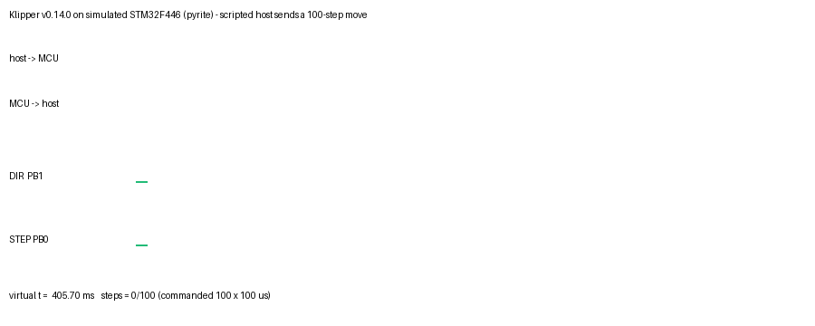

# Klipper MCU firmware in the pyrite `sim` (learning pass)

Target: STM32F446RE, Klipper v0.14.0 (c9559fa04), `sim` 0.10.6 on an Apple M5. No PRs, no upstream contact.

## Build
`sim/build.sh` (needs arm-none-eabi-gcc; tested with Arm GNU 15.2.1). Config: `sim/k446.config`
(`CONFIG_MACH_STM32F446`, flash start 0x0000, 8 MHz HSE, USART2 PA3/PA2, 250000 baud). Result: text 43796, data 64, bss 1100.
Build traps: `make` with macOS `cpp` fails on `armcm_link.lds.S` (use `CPP=arm-none-eabi-cpp`). macOS ships GNU Make 3.81,
which expands `CONFIG_BOARD_DIRECTORY` empty in the board-link rule, so `out/board` links to `src/` instead of `src/stm32/`,
`board/gpio.h` resolves to the generic `src/gpio.h`, and `src/i2ccmds.c` fails with implicit `i2c_setup/i2c_write/i2c_read`.
Not a Klipper bug (clean v0.14.0 source; Klipper targets Linux hosts with Make 4). `build.sh` uses `gmake` when present:
`brew install make`. Checked: Make 3.81 -> `out/board -> src/`, gmake 4 -> `out/board -> src/stm32`, ELF builds.

## Run
```
cp out/klipper.elf sim/            # not committed
cd sim && sim run --scenario scenario.yaml --timeout 0.8 --record ./rec -v    # in-sim scripted host (klipper_host_peer.py)
sim STM32F446RE run --elf out/klipper.elf --uart-tcp usart2:5600 --timeout 20 -q &   # single machine, real time
python3 identify_peer.py 5600 dict.json                                              # host over TCP
```

## Results


`klipper-move.gif` is drawn by `make_gif.py` from a `--record` bundle of the scenario run (UART bytes per direction, PB0/PB1 edges):
`uv run --with pillow make_gif.py ./rec`.

| Rung | Result |
| --- | --- |
| 1. Boots | Yes. Reaches `sched_main`; sends `starting` (`06 10 7D D2 19 7E`) at 0.535 ms; periodic `stats` every 5 s; 0 faults. |
| 2. identify | Yes, both ways: `identify_peer.py` over `--uart-tcp`, and `klipper_host_peer.py` as a `ScriptedUartPeer` inside a scenario. Dictionary: v0.14.0, 124 commands, 29 responses, MCU stm32f446xx, CLOCK_FREQ 180000000. |
| 3. Move | Partial. Scripted host sends allocate_oids, config_stepper (PB0 step, PB1 dir), finalize_config, reset_step_clock, queue_step (100 steps, 100 us). `--record` gpio.jsonl: 100 rising edges on PB0, interval 99.856 to 100.000 us (mean 99.999), width 372-506 ns, first edge 0.433350 s (rerun 2026-11-22 after the build fix), dir PB1 high before it. Real `klippy` was not run (see below). |

Numbers: idle boot, 30 s virtual: 199,115 guest instructions, 0.03 s wall. Scenario move run, 0.8 s virtual (identify + move): 1,262,295 guest instructions, 0.231 s wall. `sim` prints no host-instruction count here, so no host/guest ratio.

Recording cost (same scenario, 0.8 s virtual, 3 runs each, alternating): plain 1.10 / 1.17 / 0.95 s wall, `--record`
1.31 / 1.09 / 1.48 s; the difference is inside run-to-run noise, process start dominates (0.24 s user). Bundle: 4.8 MB
(7973 frame, 28674 isr, 204 gpio, 181 uart records). `peer.board` declares the 8 MHz HSE (`rcc: hseFrequency`), which
removes pyrite's "board declares no hseFrequency" warning; the assumed value was already 8 MHz, so results are unchanged.

## Failures
1. Single-machine `run --elf`: SysTick is delivered on a 10 ms grid, so Klipper shuts down "Rescheduled timer in the past" (static string 52) at 1.31 s idle, or ~9.6 s with a host attached. Cause: model/engine, filed as simantic-dev/pyrite#4051. The same ELF as a one-machine scenario with `quantum: 0.00001` is on time (first wrap-timer SysTick at 0.093740 s, as `0xffffff/180e6 + 0.00053` predicts) and runs 12 s without shutdown.
2. `--uart-pty` and `--uart-tcp` are single-machine only, so real `klippy` (pty) can only run in the mode hit by #4051. Not attempted; system Python lacks pyserial/cffi. Unverified.
3. Peer bugs fixed along the way (scenario/peer errors, not model): sync byte 0x7E also occurs in payloads (frame by length), ids >127 are 2-byte VLQ, pin enumeration is `[base, count]`.
4. Observation, not filed: in `--uart-tcp` logs, TX frames carry timestamps ~10 ms earlier than the RX that caused them; the log stamps look batched.
